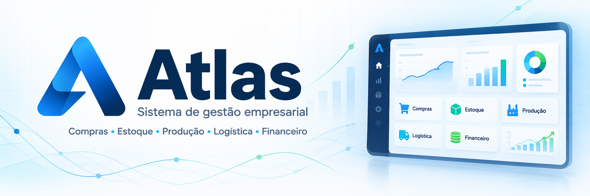

# Olá, eu sou Milton Junior 👋

### Criador do Atlas | Desenvolvedor Full Stack

Transformo rotinas de negócio em sistemas claros, seguros e fáceis de usar.

---

## Sobre mim

Sou desenvolvedor de software com foco em aplicações web e sistemas empresariais. Gosto de entender a operação de ponta a ponta e transformar processos de compras, estoque, produção, logística e financeiro em soluções confiáveis e rastreáveis.

Atualmente, meu principal projeto é o **Atlas**, um sistema de gestão empresarial multiempresa desenvolvido para atender operações reais, com controle de permissões, auditoria, segurança de dados e experiência responsiva.

- 📍 Monte Mor, São Paulo
- 💼 Foco em sistemas de gestão e automação de processos
- 🧩 Experiência com aplicações multi-tenant e regras de negócio complexas
- ✅ Valorizo testes, rastreabilidade, segurança e boa usabilidade

## Projeto principal

  

### Atlas — Sistema de gestão empresarial

O **Atlas** é o projeto que concentra hoje meu trabalho de arquitetura, desenvolvimento e evolução de produto. É um sistema web criado para centralizar e dar rastreabilidade à operação de uma empresa, do pedido ao financeiro.

**Principais áreas:**

- Cadastro de clientes, fornecedores, produtos e tabelas de preços
- Pedidos, reservas de estoque e acompanhamento de entregas
- Compras, recebimentos previstos e conferência de mercadorias
- Ordens de produção e controle de insumos
- Cargas, rotas, romaneios e logística de entrega
- Contas a pagar e receber, parcelas e comprovantes
- Controle de acesso, auditoria e isolamento por empresa

**Tecnologias:** Laravel, PHP, MySQL, Blade, JavaScript, HTML e CSS.

> O código é privado por conter regras específicas da operação, mas o projeto representa minha experiência prática com arquitetura, banco de dados, segurança, testes, implantação e evolução contínua de produto.

## Tecnologias

## Outros projetos

### [Sistema para barbearias](https://github.com/MiltonJunior1711/Barbearia)

Aplicação web com recursos de agendamento, serviços, produtos e experiência PWA, desenvolvida com PHP, JavaScript, HTML e CSS.

### Automação e integrações

Experimentos e soluções com APIs, mensageria e automação de atendimento, incluindo integrações com WhatsApp e serviços de apoio a processos empresariais.

## Como eu trabalho

- Entendimento do processo antes da implementação
- Regras de negócio protegidas por validações e permissões
- Banco de dados estruturado com migrations e rastreabilidade
- Testes automatizados e revisão antes da publicação
- Interfaces responsivas pensadas para uso diário
- Implantação e suporte evolutivo em ambientes de QA e produção

---

### Vamos conversar?

Estou aberto a conexões, projetos e oportunidades na área de desenvolvimento de software.

[LinkedIn](https://www.linkedin.com/in/milton-junior-b298501b4/) · [GitHub](https://github.com/MiltonJunior1711)

